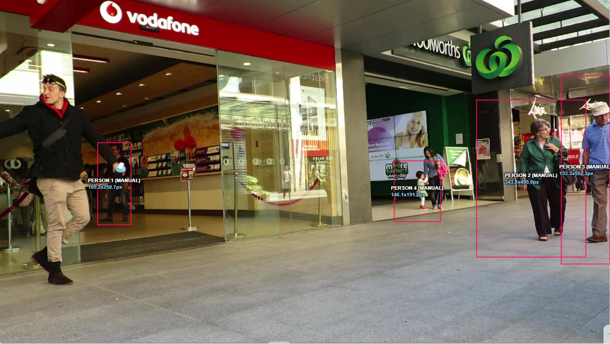

# Báo cáo cá nhân — HoVaTen-MSSV

Đổi tên file theo quy tắc `MSSV_HoTen.md`. Ví dụ: `20241234_NguyenVanAn.md`.

Đoạn video: MOT17-09, 150 frame (frame 1–150), nguồn MOTChallenge, giấy phép CC BY-NC-SA 3.0.

## 0. Thông tin học viên

- Họ tên: Nguyễn Hoàng Thành  
- MSSV: 202603296
- Mã đề (A/B/C): A
- Email: nhthanh194378@gmail.com
- Link repository: https://github.com/TT1172001/K5-L2-03296-NguyenHoangThanh-Day05-MOTTracking
- Giờ bắt đầu: 16h 13/11
- Giờ kết thúc: 11h30 14/11

## 1. Xem trước đoạn video (CP0)

Ghi **trước khi vẽ**, mỗi người một dòng.

| Mã | Frame xuất hiện | Frame cuối thấy được | Rẽ / dừng / đổi tốc độ ở frame | Bị che ở frame | Ghi chú |
|---|---|---|---|---|---|
| P1 | | | | | |
| P2 | | | | | |
| P3 | | | | | |
| P4 | | | | | |
| P5 | | | | | |

## 2. Keyframe và thời gian (CP1, CP4)

Số keyframe lấy từ kết quả `src/check_submission.py`.

| Mã | Số keyframe | Keyframe ở frame | Số frame có mặt | Keyframe / 100 frame | Thời gian (phút) | Chỗ khó |
|---|---|---|---|---|---|---|
| P1 |8 |0, 29, 48, 52, 65, 71, 89, 142 |143 |5.6 | |Bị che từ frame 29-51 trong đó từ 29-42 và 50-53 bị che khuất 1 phần(occluded) từ 41-47 bị che khuất hoàn toàn(outside) |
| P2 |3 |0, 79, 149 |150 |2.0 | |Người này di chuyển tương đối tuyến tính và kích thước xuất hiện trong khung hình cũng lớn nên không gặp vấn đề gì khi tracking |
| P3 |8 |0, 20, 88, 89, 90, 118, 126, 149 |150 |5.3 | |Người này di chuyển tương đối tuyến tính và kích thước xuất hiện trong khung hình cũng lớn nên không gặp vấn đề gì khi tracking |
| P4 |7 |0, 106, 136, 137, 140, 143, 146 |121 |5.8 | |Bị che từ frame 110-135 |
| P5 |7 |40, 51, 55, 57, 62, 83, 140 |110 |6.4 | |Người này chỉ xuất hiện từ frame 40, từ frame 40-61 bị che khuất 1 phần, đặc biệt từ frame 40-56 phần thân dưới của người này bị quầy hàng che khuất nên chỉ tracking được phần thân trên |
| **Tổng** |33 | |674 |4.9 | | |

Keyframe / 100 frame của cả bài = tổng keyframe ÷ tổng số frame có mặt × 100 = ...

Bạn đặt keyframe nhiều nhất ở người nào? Vì sao (người đó rẽ, dừng, lại gần camera hay bị che)?
Tôi đặt keyframe nhiều nhất ở người đàn ông áo đen bên trong cửa hàng vì người đó bị che 23 frame và người đó có quỹ đạo di chuyển lại gần camera.

...

## 3. Đoạn bị che (CP2)

Người bị che: `P1`

| Mốc | Frame |
|---|---:|
| Bắt đầu bị che một phần (bật `occluded`) |29 |
| Mất hẳn (bật `outside`) |41 |
| Hiện lại (tắt `outside`) |48 |
| Thấy rõ trở lại (tắt `occluded`) |54 |

- Thời gian khuất hẳn: 8 frame = 0.267 giây.
- Quyết định: giữ cùng ID.
- Lý do (trả lời 3 câu: khuất bao lâu so với 60 frame, ngoại hình có khớp, chỗ hiện lại có đúng hướng và tốc độ):
1. Thời gian khuất: P1 chỉ bị khuất hẳn 8 frame (~0.33 giây), ngắn hơn rất nhiều so với ngưỡng 60 frame.
2. Ngoại hình có khớp: Người xuất hiện lại có ngoại hình hoàn toàn trùng khớp.
3. Chỗ hiện lại: Vị trí xuất hiện lại hoàn toàn đúng theo hướng và quỹ đạo chuyển động: tiếp tục bước đi thẳng đều từ trái sang phải bên trong cửa hàng. -> Quyết định giữ cùng ID.

...

Ảnh chụp màn hình:

## 4. Tự review ID (CP3)
Đã kiểm hai lượt, không lỗi

## 5. File xuất và kết quả tự kiểm (CP4)

| Kiểm tra | Kết quả |
|---|---|
| Tên file MOT 1.1 | |
| Tên file CVAT for video 1.1 | |
| Số track ID khác nhau trong `gt/gt.txt` (phải là 5) | |
| Frame `outside` không có dòng trong `gt.txt` (đúng / sai) | |
| Job đã completed trên CVAT máy cá nhân | |

Dán phần tóm tắt in ra từ `src/check_submission.py`:
Số frame in theo CVAT (bắt đầu từ 0). Trong gt.txt, frame_id = frame CVAT + 1.

=== File MOT 1.1: NguyenHoangThanh_mot.zip ===
  Số track ID: 5   |   Tổng số box: 674
  [OK]        Đúng 5 track ID.

  Track | Frame có mặt | Số frame | Đoạn vắng (outside)
      1 |   0–149      |      143 | 41–47
      2 |   0–149      |      150 | -
      3 |   0–149      |      150 | -
      4 |   0–146      |      121 | 110–135
      5 |  40–149      |      110 | -

  [CẢNH BÁO]  Track 5: chiều cao box đổi > 30% trong 1 frame ở frame [56, 57]. Kiểm tra box co giật (co box theo phần nhìn thấy?).

=== File CVAT for video 1.1: NguyenHoangThanh_cvat_video.zip ===

  Track | Nhãn   | Frame thấy | Keyframe | KF/100 frame | Frame occluded | Lần bật outside
      0 | person |        143 |        8 |          5.6 |             16 |               1
              Track 0: keyframe ở frame [0, 29, 48, 52, 65, 71, 89, 142]
      1 | person |        150 |        3 |          2.0 |              0 |               0
              Track 1: keyframe ở frame [0, 79, 149]
      2 | person |        150 |        8 |          5.3 |              0 |               0
              Track 2: keyframe ở frame [0, 20, 88, 89, 90, 118, 126, 149]
      3 | person |        121 |        7 |          5.8 |             12 |               2
              Track 3: keyframe ở frame [0, 106, 136, 137, 140, 143, 146]
      4 | person |        110 |        7 |          6.4 |             22 |               0
              Track 4: keyframe ở frame [40, 51, 55, 57, 62, 83, 140]

  Tổng: 33 keyframe / 674 frame có mặt = 4.9 keyframe / 100 frame
  [OK]        Đọc được 5 track từ annotations.xml.

=== Tóm tắt ===
  Lỗi: 0   |   Cảnh báo: 1
  Không có lỗi định dạng. Mở CVAT xem lại từng [CẢNH BÁO]; cảnh báo đúng ý bạn thì ghi lý do vào báo cáo.

Lý do xuất hiện cảnh báo:
Chiều cao box đổi bởi vì ở frame 56, phần thân dưới của đối tượng bị che khuất bởi quầy hàng, tôi chỉ thực hiện gán nhãn cho phần nhìn thấy. Khi sang frame 57, phần thân dưới của đối tượng lộ ra, tôi thực hiện gán nhãn cho cả cơ thể đối tượng nên chiều cao box có sự chênh lệch rõ ràng.

## 6. Ba câu kết

1. Nếu được gán lại, bạn sẽ đặt keyframe khác ở đâu? Vì sao?
   Nếu được gán lại, tôi sẽ đặt lại track P5 từ frame 57. Vì những frame đầu P5 rất khó nhìn và nếu chỉ track phần nhìn thấy rồi về sau thì nó sẽ dịch chuyển độ rộng box rất nhanh trong vài frame.

2. Có chỗ nào bạn không chắc "cùng ID hay ID mới"? Bạn đã quyết định và ghi chú thế nào?
   Không có.

3. Một lỗi ID trong job của bạn (nếu không còn sót, chọn lỗi đã sửa) có thể làm xe tự lái dự đoán sai chuyển động của người đó như thế nào? Lỗi đó ảnh hưởng MOTA hay IDF1 nhiều hơn?

   Ảnh hưởng xe tự lái: Nếu xảy ra lỗi id_switch (ví dụ ID của P1 nhảy sang P5 khi cắt mặt), hệ thống tracking của xe tự lái sẽ gộp quỹ đạo 2 người thành một track duy nhất. Điều này làm vector vận tốc tức thời tính toán bị nhảy vọt bất thường. Module dự đoán quỹ đạo (trajectory prediction) sẽ phán đoán sai rằng người đi bộ đang lao sang làn đường với tốc độ cực lớn, dẫn đến việc xe tự lái phanh gấp khẩn cấp (phantom braking) hoặc đánh lái né tránh sai lầm, gây nguy hiểm.
   Ảnh hưởng MOTA hay IDF1: Lỗi này ảnh hưởng IDF1 nhiều hơn MOTA. MOTA tính tổng lỗi theo từng frame độc lập (FN + FP + IDSW), nên một lần đổi ID chỉ bị phạt 1 điểm IDSW, làm MOTA giảm rất ít (< 1–2%). Trong khi đó, IDF1 đo lường mức độ duy trì định danh xuyên suốt của một track (ID consistency); khi một người bị chia làm 2 ID, toàn bộ nửa sau của track sẽ bị tính là sai ID, khiến điểm IDF1 tụt giảm nặng nề

## Bonus (nếu làm)

### B1 — Hai người đi sát

...

### B2 — So cách đặt keyframe

| Cách đặt | Số keyframe | Frame trôi nhất | Ghi chú |
|---|---:|---:|---|
| Đều mỗi 30 frame | | | |
| Theo chỗ đổi hướng | | | |

...

### B3 — So với tracker có sẵn

| Frame | Mã người | Tracker làm gì | Nhãn của bạn | Giải thích (đoán rồi sửa / ghép IoU / box score thấp / ngoại hình) |
|---:|---|---|---|---|
| | | | | |
| | | | | |

## 7. Tài liệu tham khảo và công cụ AI đã dùng

...
